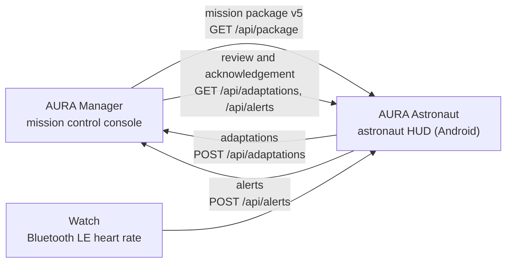

# AURA — Astronaut Unified Readiness & Autonomous-health

Project for the **NASA Space Apps Challenge 2026**, challenge *Create Health Monitoring Software for Astronauts on Space Missions*.

AURA helps a crew keep the physical capacities they need for every day of a mission (strength, coordination, balance, exercise tolerance) and, above all, arrive at each **gravity change** — landing, leaving the spacecraft, returning to Earth — able to walk out on their own. It never claims they will: it watches the indicators that make it likely, protects the measures that prepare it and warns in time when something deviates.

AURA is mission-agnostic. Everything specific to a mission (flight days, gravity environments, events, questionnaire, thresholds) travels in a versioned mission package, so the same software serves the Moon, Mars or a space station. The demo uses the **planned timeline of Artemis II**.

## Two parts

| Part | Folder | What it is |
| --- | --- | --- |
| **AURA Manager** | [`aura-manager/`](aura-manager/README.md) | Mission control web console (Next.js). Builds the mission plan and each astronaut's prevention plan, validates it and publishes the mission package. Receives the adaptations and alerts sent from orbit. Live at **https://aura-manager-rouge.vercel.app** |
| **AURA Astronaut** | [`aura-astronaut/`](aura-astronaut/README.md) | Android app for the astronaut: a camera-based heads-up display that shows what to do today, runs the daily self-assessment, adapts the plan within the limits mission control allows and works fully offline. |



1. **Mission control plans.** In AURA Manager, mission control sets the timeline in Mission Elapsed Time (MET), the gravity environment and operational load of each flight day, and schedules prevention activities (exercise, nutrition, assessments, supplements, recovery, transition preparation). Rules flag what would put the crew at risk, such as demanding load before a critical day or a gravity transition with no preparation.
2. **The package travels.** Publishing produces a versioned, checksummed JSON package (`aura.mission-package/v5`) with the plan, the adaptation policy, the daily questionnaire, the traffic-light capacities and their demonstration thresholds. Every human-readable text comes in English and Spanish.
3. **The astronaut acts.** The app shows the day's plan over the camera image, asks a short daily questionnaire, reads the watch's heart rate and grades each capacity green, amber, red or gray (no data). When something deviates, it adapts only what mission control marked as adaptable (exercise and menus), never raising the load, and explains why.
4. **Mission control reviews.** Every adaptation is applied on board at once and sent without blocking; mission control validates it or objects to it. What adapting cannot solve — a capacity in red, a lost transition preparation, a self-report that contradicts the sensor — is sent as an alert, and the astronaut sees when it has been seen and handled.

## Principles

- AURA **does not diagnose** and does not certify that anyone is fit. It shows indicators, always with text and a reason; color never goes alone, and gray means insufficient data.
- No clinical thresholds or doses are invented. All thresholds in the prototype are demonstration rules and labeled as such; supplement doses stay empty until a medical protocol sets them.
- Simulated data is always labeled as simulated. In the demo there is no smart garment: its signals are simulated; the watch heart rate is real.
- Health data stays on the astronaut's device; only adaptations and alerts, with their evidence, reach mission control.
- Fixed operations (maneuvers, tests, sleep, operations) are never changed from the astronaut side.

## Data sources

- **Timeline:** NASA "Artemis II Overview Timeline" (2026-03-18, approved for public release, STRIVES 20260002249). Events and their MET come from the document; crew activity blocks are read from its chart and are approximate (±15 min).
- **Prevention references:** NASA OCHMO *Exercise Overview*, NASA *Sensorimotor Risk* and NASA *Pre-/Postflight Medical Care* pages, cited in the catalog.
- **Daily questionnaire:** the team's "ARTEMIS-MED" document; each question is inspired by a published instrument (Samn-Perelli, SANS screening, VISA-A, Oswestry, ABC scale…), which a single question does not replace.
- **Team example, not NASA data:** each day's operational load, the demonstration crew (CDR, PLT, MS1, MS2) and the whole prevention plan.

## Getting started

```bash
# Mission control console
cd aura-manager
npm install
npm run dev            # http://localhost:3000

# Astronaut app (Android SDK and JDK 21)
cd aura-astronaut
./gradlew testDebugUnitTest assembleDebug
```

See each part's README for details: [AURA Manager](aura-manager/README.md), [AURA Astronaut](aura-astronaut/README.md). The full functional specification of the astronaut app is [`aura-astronaut/AGENTS.md`](aura-astronaut/AGENTS.md), and the contract between both parts is documented in [`aura-astronaut/contract/`](aura-astronaut/contract/).

## Languages

The console, the app and the data are multilingual: **English** is the reference language and **Spanish** the second one. Codes and identifiers are always English; every text in the mission package is a `LocalizedText` (`{ "en": "…", "es": "…" }`) and each client shows it in its own language, falling back to English.

## Third-party content

- The 3D silhouette mesh is adapted from BodyParts3D, © The Database Center for Life Science (DBCLS), CC BY-SA 2.1 Japan; see `aura-astronaut/app/src/main/assets/models/LICENSE-body.txt`.
- NASA documents are cited as sources; AURA is not a NASA product and is not endorsed by NASA.
