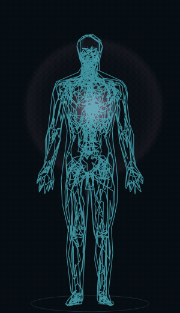

# AURA Astronaut

The astronaut interface of **AURA (Astronaut Unified Readiness & Autonomous-health)**, a project for the NASA Space Apps Challenge 2026. It is one of the two parts of the [AURA repository](../README.md); the other is the mission control console, [AURA Manager](../aura-manager/README.md).

An Android app that turns a tablet or phone into a heads-up display: the rear camera fills the screen and the HUD overlays what the astronaut needs to know and do **today**, in Mission Elapsed Time, with special attention to the next **gravity change** (launch, landing, return to Earth). It works fully **offline**.



## What it does

- **Mission context:** MET clock, flight day, phase, milestone, gravity environment and operational load, all read from the mission package published by AURA Manager.
- **Gravity transition panel:** countdown to the next transition, the capacities critical for egress with their day-by-day trend, and compliance with the preparation measures. It speaks of "indicators for egress", never of "fit".
- **Day plan:** the astronaut's prevention activities in context with the mission timeline (sleep, meals, maneuvers), with the next recommended action and its rationale.
- **Daily questionnaire and traffic light:** questions selected by triggers from the package; each capacity is green, amber, red or gray (no data), always with text and a reason. Thresholds are for demonstration and labeled as such.
- **Plan adaptation:** a single rules module may substitute, reschedule or omit the activities mission control marked as adaptable (exercise and menus), never raising the load. Every decision is applied on board immediately and sent to mission control in the background for validation.
- **Alerts to mission control:** capacities in red, lost transition preparation and self-report/sensor inconsistencies, with acknowledgement shown back to the astronaut.
- **Live heart rate** from a watch over the standard Bluetooth LE Heart Rate profile (tested with a Garmin Forerunner 745), or a simulated source for the demo.
- **3D silhouette** that replays the steps and squats detected by the tablet's accelerometer, with the working muscle groups and a heart beating at the measured rate. It is simulated and visual only.
- **Voice notices** with the system text-to-speech engine, offline, saying only what is on screen and only once.
- **English and Spanish:** interface texts from Android resources and package texts from multilingual `LocalizedText` fields.

The app does not diagnose, does not certify fitness, never invents thresholds or doses, labels simulated data as simulated and keeps health data on the device.

## Build and run

Requirements: Android SDK (compile SDK 37), JDK 21. Minimum Android version: 10 (API 29).

```bash
cd aura-astronaut
export JAVA_HOME=/path/to/jdk-21   # if Java is not on the path
./gradlew testDebugUnitTest         # unit tests
./gradlew assembleDebug             # app/build/outputs/apk/debug/app-debug.apk
./gradlew installDebug              # install on a connected device or emulator
```

Or open the folder in Android Studio and run the `app` configuration.

The app starts with the mission package embedded in `app/src/main/assets/mission-package.json` (the Artemis II demo mission) and checks AURA Manager for a newer one when there is a network connection.

### Mission control server

The default server is the deployed AURA Manager, `https://aura-manager-rouge.vercel.app` (`BuildConfig.MANAGER_URL` in `app/build.gradle.kts`). In demo mode it can be switched to a local Manager (`npm run dev` in `../aura-manager`):

- emulator: `http://10.0.2.2:3000`;
- device over USB: `http://localhost:3000` after `adb reverse tcp:3000 tcp:3000`.

Unencrypted HTTP is allowed only for those local hosts and only in the debug build (`app/src/debug/res/xml/network_security_config.xml`).

## Demo mode

A side panel for the presenter (not the astronaut) to:

- set the MET by hand, jump between events and run time accelerated (up to 1 h per second), or follow the clock from `launchUtc`;
- choose the crew member;
- load one of three **simulated** scenarios: stable profile, accumulated fatigue after a critical day, and worsening coordination;
- force the silhouette's movement (walk, squat, still) if the sensor fails live;
- choose the heart rate source (watch, simulated, off) and set up the watch;
- repeat the voice notices, change the app language (Android 13+);
- check for a new package, go back to the embedded one, or change the Manager URL.

Everything can be shown in **airplane mode**.

## Code structure

`app/src/main/java/com/aura/astronaut/`:

| Package | Contents |
| --- | --- |
| `mission` | Mission package models (v5), parser with checksum verification, MET and mission clock, `LocalizedText`. |
| `assessment` | Traffic light (`CapacityEvaluator`), questionnaire selection, adaptation rules (`AdaptationEngine`), on-device policy check, alerts, transition readiness, demo scenarios. |
| `hud` | What the HUD shows at a given MET (`MissionSnapshot`), the day timeline, and the texts shared by HUD and voice (`HudTexts`). |
| `data` | Room database: confirmations, observations, adaptations and alerts. |
| `sync` | Mission control client, send queue for adaptations and alerts, package download. |
| `heart` | Bluetooth LE heart rate and the simulated source. |
| `motion` | Step and squat detection from the accelerometer (simulated muscle activity). |
| `voice` | Text-to-speech notices. |
| `state` | `AuraViewModel` and stored settings. |
| `i18n` | Access to string resources from non-Compose code; active language. |
| `ui` | Jetpack Compose screens: camera background, HUD panels, data collection, silhouette, demo panel. |

Unit tests (`app/src/test`) cover package parsing and checksum, MET, the questionnaire, the traffic light, the adaptation rules (no rule may adapt something fixed or leave the policy), alerts, transition readiness, heart rate parsing, motion detection, package updates and the string resources in both languages.

## Contract with AURA Manager

- `contract/mission-package.example.json`: a real v5 package generated by the Manager; the embedded package is an identical copy (a test checks it).
- `contract/v4-to-v5.md`: mapping from the previous contract (Spanish codes) to v5.
- `contract/pending-changes.md`: data the app would need and the package does not carry yet.
- The type definitions live in `../aura-manager/lib/package.ts` and `../aura-manager/lib/types.ts`.

`AGENTS.md` is the complete functional specification of the app.

## Credits

The 3D silhouette mesh is adapted from BodyParts3D, © The Database Center for Life Science (DBCLS), CC BY-SA 2.1 Japan, via anatomia.alexisparron.com (CC BY-SA 4.0); see `app/src/main/assets/models/LICENSE-body.txt`. `docs/silueta/silueta.html` renders the same silhouette in a browser.
